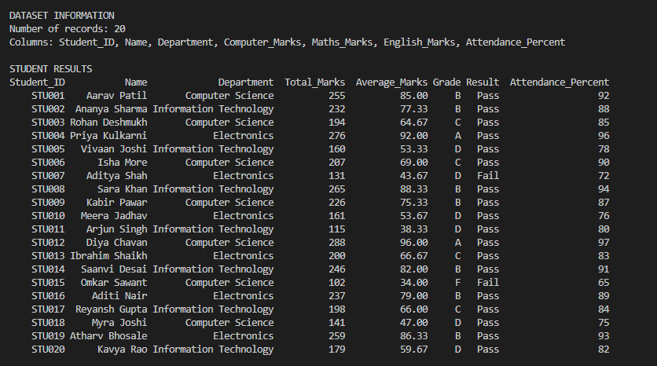
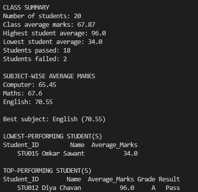

# Project Documentation

# Student Performance Analytics System

## 1. Student Details

Student Name: Jahur Mahammadshafik Jamadar

Course: Python with AI

Institute: EWB Courses

Project Title: Student Performance Analytics System

GitHub Repository: https://github.com/jahur-creator/Student-Performance-Analytics-System

## 2. Project Objective

The objective of the Student Performance Analytics System is to analyze student academic performance using Python, NumPy, and Pandas. The project processes student marks, calculates subject-wise totals and averages, assigns grades, identifies pass or fail status, and summarizes overall class performance.

The system also identifies the highest-performing and lowest-performing students, calculates subject-wise class averages, and displays the top performers. This project demonstrates the use of Python functions, loops, conditional statements, NumPy numerical operations, and Pandas DataFrames for student performance analysis.

## 3. Technologies Used
- Python
- NumPy
- Pandas

## 4. Dataset Description
The dataset is stored in `students.csv` and contains 20 sample student records (sample data, not real students). The columns are Student_ID, Name, Department, Computer_Marks, Maths_Marks, English_Marks, and Attendance_Percent.

## 5. Implementation
1. Pandas loads `students.csv` into a DataFrame.
2. The program checks that the required columns are present.
3. Reusable functions calculate total marks and average marks for each student.
4. NumPy is used for numerical calculations and rounding averages.
5. Conditions assign grades and determine pass/fail status.
6. Pandas calculates class statistics, subject-wise average marks, the best subject, and the lowest-performing students.
7. The program displays the student results, class summary, subject-wise averages, best subject, lowest performer, and top performers.

### Grading Rule
The assignment asks for a clearly defined grading rule but does not specify grade boundaries. This project uses:
- Total: sum of the three subject marks.
- Average: total divided by 3.
- A: average marks of 90 or above
- B: average marks of 75 to below 90
- C: average marks of 60 to below 75
- D: average marks of 35 to below 60
- F: average marks below 35

### Pass/Fail Rule
A student passes if they score at least 35 marks in every subject. Otherwise, the student is marked Fail.

## 6. Key Features
- Loads and organizes student records using a Pandas DataFrame.
- Uses NumPy for numerical calculations.
- Calculates each student's total and average marks.
- Assigns grades using the stated grading rule.
- Identifies pass/fail students.
- Displays highest, lowest, and class average performance.
- Calculates subject-wise average marks.
- Identifies the best-performing subject and the lowest-performing student(s).
- Identifies top-performing student(s).
- Handles a missing, empty, or badly formatted CSV file with clear error messages.
- Uses reusable functions and iteration.

## 7. Output / Screenshots
Run `python main.py` and add screenshots of:
- The student results table.
- The class summary.
- The subject-wise average marks, best subject, and top-performing student(s).

## 8. Final Outcome
The program ran successfully on the 20-record dataset and produced all required outputs:
- Class average marks: 67.87
- Highest student average: 96.0 (Diya Chavan, grade A)
- Lowest student average: 34.0 (Omkar Sawant, grade F)
- Students passed: 18; students failed: 2
- Best subject: English (70.55)

The project met the assignment goals of loading student data into Pandas, calculating totals and averages, assigning grades, determining pass/fail status, and summarizing class performance.

## 9. Challenges & Learning
Challenges and solutions
- `print()` vs `return`: My functions showed results with `print()`, so the values couldn't be passed to other functions. I changed them to `return` the results.
- **Loop indexing errors:** I got `IndexError` and skipped items because of how `range()` works. I fixed it by tracing the loop values and iterating over items directly where possible.
- **Lists vs NumPy arrays:** I expected NumPy to behave like Python lists. I learned that NumPy arrays hold one data type and are faster for numerical calculations.
- **DataFrame selection:** I got `KeyError` when selecting several columns. I learned that `df[['Name', 'Maths_Marks']]` needs double brackets, and that `.iloc[]` selects rows by position.

**Key learnings**
- **Functions and loops:** Functions avoid repeated code, and loops with `if-elif-else` process each student's marks and apply the rules.
- **NumPy and Pandas:** Pandas loads the CSV into a table, and filtering with conditions such as `df[df['Average_Marks'] > 80]` selects matching rows without nested loops.

## 10. GitHub Repository
Repository URL: https://github.com/jahur-creator/Student-Performance-Analytics-System
